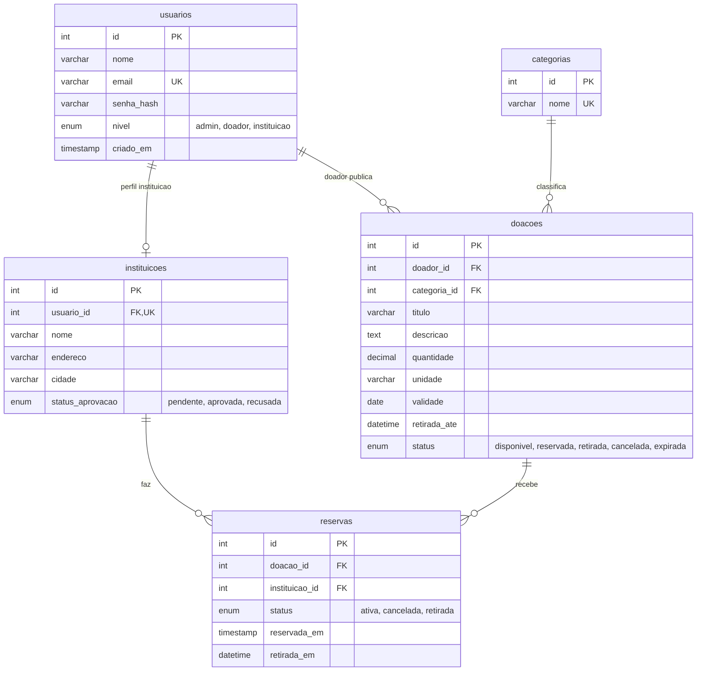

# Ponte Alimentar

Sistema web que conecta estabelecimentos com alimentos excedentes (mercados, padarias, restaurantes) a instituições que atendem pessoas em situação de vulnerabilidade (ONGs, abrigos, cozinhas comunitárias).

> **Status:** Entrega 2 concluída — banco de dados MySQL, cadastro, login, JWT e controle de acesso por perfil.
> CRUD de doações, reservas e interface web serão feitos na Entrega 3.

---

## 1. Problema identificado

### Contexto
Diariamente, estabelecimentos descartam alimentos ainda próprios para consumo: produtos perto da validade, sobras de produção, itens com embalagem danificada ou excesso de estoque. Ao mesmo tempo, instituições sociais precisam de alimentos para atender famílias em situação de insegurança alimentar.

O problema não é apenas a falta de alimento, mas a **falta de comunicação organizada** entre quem tem excedente e quem precisa dele. Hoje essa conexão acontece por contatos informais (ligações, grupos de mensagens, conhecidos), o que gera:

- doações que não acontecem porque o alimento vence antes de alguém saber que ele existe;
- doadores sem canal simples para oferecer o excedente;
- instituições que não sabem o que está disponível nem quando retirar;
- falta de registro e acompanhamento do que foi doado e retirado.

> **Dado de apoio (preencher antes de entregar):** inserir aqui 1 ou 2 dados oficiais sobre desperdício de alimentos e insegurança alimentar no Brasil, com a fonte citada (ex.: FAO, IBGE, Rede PENSSAN).

### Público afetado
- **Estabelecimentos doadores:** perdem alimento e não têm canal simples para doar.
- **Instituições sociais:** têm dificuldade de acessar alimentos e de planejar a retirada.
- **Famílias atendidas pelas instituições:** são o público final, afetado pela falta de alimento.
- **Comunidade em geral:** sofre os impactos sociais e ambientais do desperdício.

### Justificativa
Uma plataforma centralizada reduz o tempo entre o surgimento do excedente e a retirada, organiza as doações com prazo e status e deixa um histórico verificável. A solução é viável com tecnologias web simples e pode ser adotada por pequenos estabelecimentos.

---

## 2. Proposta de solução

A **Ponte Alimentar** é uma aplicação web em que:

1. um **doador** publica um lote de alimento com quantidade, validade e prazo de retirada;
2. uma **instituição aprovada** vê as doações disponíveis e reserva as que consegue retirar;
3. o doador **confirma a retirada**, e o sistema registra o histórico;
4. um **administrador** valida as instituições e acompanha o funcionamento geral.

### Objetivos
- **Geral:** reduzir o desperdício de alimentos aproximando doadores e instituições.
- **Específicos:**
  - permitir a publicação e o gerenciamento de doações com validade e prazo;
  - evitar que um mesmo lote seja reservado por mais de uma instituição;
  - garantir que só instituições verificadas recebam doações;
  - manter histórico de doações, reservas e retiradas;
  - proteger os dados com autenticação JWT e controle de acesso por perfil.

### Tecnologias
HTML5, CSS3, JavaScript (DOM + Fetch), Node.js, Express, MySQL, `mysql2`, `jsonwebtoken`, `bcryptjs`, `dotenv`, `cors`.

---

## 3. Funcionalidades previstas

**Gerais**
- Cadastro e login com senha protegida (hash) e autenticação por JWT.
- Redirecionamento e acesso conforme o perfil do usuário.

**Doações (CRUD principal)**
- Publicar, listar, consultar, editar e excluir doações.
- Filtrar doações por categoria, status e validade.

**Reservas**
- Reservar uma doação disponível.
- Cancelar uma reserva (a doação volta a ficar disponível).
- Confirmar a retirada.

**Administração**
- Aprovar ou recusar o cadastro de instituições.
- Listar e gerenciar usuários.
- Gerenciar categorias de alimentos.
- Visualizar o histórico geral e indicadores simples (total de doações, retiradas, quantidade doada).

**Regras de negócio**
- Não é possível publicar doação com validade já vencida.
- Apenas instituições **aprovadas** podem reservar.
- Um lote só pode ter **uma reserva ativa** por vez.
- O doador só edita ou exclui as **próprias** doações, e somente enquanto estiverem *disponíveis*.
- Doações vencidas passam automaticamente para o status *expirada*.
- Uma doação *retirada* não pode mais ser alterada ou excluída (preserva o histórico).

---

## 4. Tipos de usuário e permissões

| Perfil | Quem é | Ações permitidas |
|---|---|---|
| **Doador** | Estabelecimento com excedente | Cadastrar-se; criar, editar e excluir **suas** doações; ver reservas de suas doações; confirmar retirada |
| **Instituição** | ONG, abrigo, cozinha comunitária | Cadastrar-se (aguarda aprovação); ver doações disponíveis; reservar e cancelar **suas** reservas; ver seu histórico |
| **Administrador** | Responsável pela plataforma | Aprovar/recusar instituições; gerenciar usuários e categorias; ver e moderar todas as doações; ver indicadores |

> As permissões serão validadas **na API** (middleware de autorização + conferência de dono do recurso no controller), e não apenas escondendo botões ou páginas no front-end.

---

## 5. Fluxo básico de funcionamento

```text
Cadastro → Login (JWT) → Redirecionamento conforme o perfil

DOADOR                      INSTITUIÇÃO                 ADMINISTRADOR
  │                              │                            │
  │                              │  cadastro ──────────────►  │ aprova / recusa
  │                              │ ◄────────── aprovada ────  │
  │ publica doação               │                            │
  │ (status: disponível) ───────►│ lista doações disponíveis  │
  │                              │ reserva (status: reservada)│
  │ ◄──── vê a reserva ──────────│                            │
  │ confirma retirada            │                            │
  │ (status: retirada)           │ histórico atualizado       │ acompanha indicadores
```

Fluxos alternativos:
- A instituição cancela a reserva e a doação volta para *disponível*.
- A validade passa e a doação é marcada como *expirada*.
- O doador cancela a doação antes de qualquer reserva.

---

## 6. Banco de dados

Script completo em [`sql/ponte_alimentar.sql`](sql/ponte_alimentar.sql) (MySQL 8+). Ele recria o banco `ponte_alimentar`, as tabelas, os relacionamentos e as categorias iniciais.



| Tabela | Função | Chaves e restrições |
|---|---|---|
| `usuarios` | Todos os perfis do sistema | PK `id`; `email` único; `nivel` limitado a admin/doador/instituicao; guarda apenas `senha_hash` |
| `instituicoes` | Dados extras de quem tem perfil instituição | PK `id`; FK `usuario_id` → `usuarios` (única, relação 1:1); aprovação pelo admin |
| `categorias` | Tipos de alimento | PK `id`; `nome` único |
| `doacoes` | Lotes publicados pelos doadores | PK `id`; FK `doador_id` → `usuarios`; FK `categoria_id` → `categorias`; `quantidade > 0` |
| `reservas` | Reserva de uma doação por uma instituição | PK `id`; FK `doacao_id` → `doacoes`; FK `instituicao_id` → `instituicoes`; **índice único garante só uma reserva ativa por doação** |

---

## 7. Autenticação e controle de acesso

- **Cadastro** (`POST /auth/cadastro`): valida nome, e-mail, senha (mínimo 8 caracteres) e perfil. O cadastro público aceita apenas `doador` e `instituicao`; **o perfil `admin` não pode ser criado pela API** (é criado pelo `npm run seed`). Instituições são gravadas como `pendente`. Usuário e instituição são salvos em uma **transação** (ou grava tudo, ou nada).
- **Proteção das senhas:** hash com `bcryptjs` (custo 10). Nenhuma senha em texto puro é gravada ou devolvida pela API.
- **Login** (`POST /auth/login`): confere e-mail e senha no banco. Para e-mail inexistente ou senha errada a resposta é a mesma (`E-mail ou senha inválidos`), para não revelar quais e-mails existem.
- **JWT:** no login a API gera um token assinado com `JWT_SECRET` (definido no `.env`), contendo `id` e `nivel`, com validade configurável (`JWT_EXPIRES_IN`, padrão 2h). O cliente envia o token no cabeçalho `Authorization: Bearer <token>`.
- **Middleware de autenticação** (`autenticacaoMiddleware.js`): rejeita requisições sem token, com token inválido, adulterado ou expirado (401).
- **Middleware de autorização** (`autorizacaoMiddleware.js`): `permitir('admin')`, `permitir('doador', 'admin')` etc. rejeitam perfis não autorizados (403). A checagem é feita **na API**, não apenas no front-end.
- **Aprovação de instituições:** o admin aprova ou recusa instituições. O status é devolvido no login e será usado na Entrega 3 para permitir reservas apenas a instituições aprovadas.

---

## 8. Arquitetura do back-end

Padrão: **routes → middlewares → controllers → database**, com `server.js` apenas configurando a aplicação.

```text
Cliente (HTML/CSS/JS via Fetch) ──JSON──► API Express (server.js)
   └► Middlewares (CORS, autenticação JWT, autorização por perfil)
        └► Routes ► Controllers ► SQL parametrizado ► MySQL
```

### Estrutura de pastas

```text
ponte-alimentar/
├── backend/
│   ├── server.js                         (configuração do Express e das rotas)
│   ├── routes/
│   │   ├── authRoutes.js                 (cadastro, login, perfil)
│   │   ├── usuariosRoutes.js             (somente admin)
│   │   └── instituicoesRoutes.js         (somente admin)
│   ├── controllers/
│   │   ├── authController.js
│   │   ├── usuariosController.js
│   │   └── instituicoesController.js
│   ├── middlewares/
│   │   ├── autenticacaoMiddleware.js     (valida o JWT)
│   │   ├── autorizacaoMiddleware.js      (restringe por perfil)
│   │   └── corsMiddleware.js
│   ├── database/
│   │   ├── conexao.js                    (pool MySQL)
│   │   └── seed.js                       (cria o administrador inicial)
│   ├── .env.example
│   └── package.json
├── frontend/                             (interface: Entrega 3)
│   ├── css/
│   └── js/
├── sql/
│   └── ponte_alimentar.sql
├── .gitignore
└── README.md
```

### Rotas

**Implementadas na Entrega 2**

| Método | Rota | Acesso | Descrição |
|---|---|---|---|
| POST | `/auth/cadastro` | Público | Cadastra doador ou instituição |
| POST | `/auth/login` | Público | Autentica e devolve o JWT |
| GET | `/auth/me` | Autenticado | Dados do usuário do token |
| GET | `/usuarios` | Admin | Lista usuários (sem senha) |
| GET | `/usuarios/:id` | Admin | Busca usuário por ID |
| GET | `/instituicoes?status=` | Admin | Lista instituições (filtro opcional) |
| PUT | `/instituicoes/:id/aprovacao` | Admin | Aprova ou recusa instituição |

**Previstas para a Entrega 3:** `/doacoes` (CRUD completo, doador dono e admin), `/reservas` (instituição aprovada), `/categorias` (leitura autenticada, escrita admin).

---

## 9. Como executar

**Pré-requisitos:** Node.js 18+ e MySQL 8+.

```bash
# 1. Clonar e instalar as dependências
git clone <URL_DO_REPOSITORIO>
cd ponte-alimentar/backend
npm install

# 2. Criar o banco, as tabelas e as categorias (executar na raiz do projeto)
cd ..
mysql -u root -p < sql/ponte_alimentar.sql

# 3. Configurar o ambiente
cd backend
cp .env.example .env
#   Edite o .env: DB_USER, DB_PASSWORD, JWT_SECRET, ADMIN_EMAIL e ADMIN_SENHA.
#   Para gerar o JWT_SECRET:
#   node -e "console.log(require('crypto').randomBytes(48).toString('hex'))"

# 4. Criar o administrador inicial
npm run seed

# 5. Iniciar a API
npm start        # ou: npm run dev
```

A API sobe em `http://localhost:3000` (ou na `PORT` definida no `.env`).

> O arquivo `.env` contém segredos e **não é enviado ao GitHub** (está no `.gitignore`).

## 10. Como testar (exemplos com curl)

```bash
API=http://localhost:3000

# Cadastro de doador
curl -X POST $API/auth/cadastro -H "Content-Type: application/json" \
  -d '{"nome":"Padaria Sol","email":"sol@exemplo.com","senha":"senha12345","nivel":"doador"}'

# Cadastro de instituição (fica pendente até o admin aprovar)
curl -X POST $API/auth/cadastro -H "Content-Type: application/json" \
  -d '{"nome":"Maria","email":"abrigo@exemplo.com","senha":"senha12345","nivel":"instituicao","nome_instituicao":"Abrigo Esperança","endereco":"Rua A, 10","cidade":"Santa Cruz do Sul"}'

# Login (copie o "token" da resposta)
curl -X POST $API/auth/login -H "Content-Type: application/json" \
  -d '{"email":"sol@exemplo.com","senha":"senha12345"}'

# Rota protegida
curl $API/auth/me -H "Authorization: Bearer SEU_TOKEN"
```

Resultados esperados:

| Teste | Resultado |
|---|---|
| Cadastro válido | 201 |
| E-mail repetido | 409 |
| Cadastro com `"nivel":"admin"` | 400 |
| Senha com menos de 8 caracteres | 400 |
| Login com senha errada ou e-mail inexistente | 401 (mesma mensagem) |
| `/auth/me` sem token, com token inválido ou expirado | 401 |
| `GET /usuarios` com token de doador ou instituição | 403 |
| `GET /usuarios` com token de admin | 200 |
| `PUT /instituicoes/:id/aprovacao` com token de doador | 403 |
| `PUT /instituicoes/:id/aprovacao` com token de admin | 200 |

## 11. Cronograma das entregas

| Entrega | Foco | Situação |
|---|---|---|
| 1 | Problema, proposta e estrutura inicial | Concluída |
| 2 | Banco de dados, autenticação e JWT | Concluída |
| 3 | CRUD, integração e permissões | Pendente |
| 4 | Projeto completo, documentação e apresentação | Pendente |
