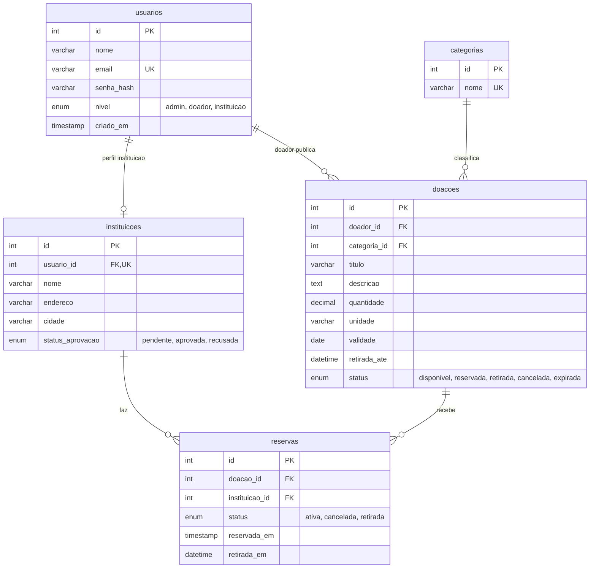

# Ponte Alimentar

Sistema web que conecta estabelecimentos com alimentos excedentes (mercados, padarias, restaurantes) a instituições que atendem pessoas em situação de vulnerabilidade (ONGs, abrigos, cozinhas comunitárias).

> **Status:** versão final (Entrega 4) — cadastro, login com JWT, três perfis de acesso, CRUD de doações, reservas, gerenciamento de usuários, indicadores, interface web completa e testes automatizados.

---

## 1. Problema identificado

### Contexto
Diariamente, estabelecimentos descartam alimentos ainda próprios para consumo: produtos perto da validade, sobras de produção, itens com embalagem danificada ou excesso de estoque. Ao mesmo tempo, instituições sociais precisam de alimentos para atender famílias em situação de insegurança alimentar.

O problema não é apenas a falta de alimento, mas a **falta de comunicação organizada** entre quem tem excedente e quem precisa dele. Hoje essa conexão acontece por contatos informais (ligações, grupos de mensagens, conhecidos), o que gera:

- doações que não acontecem porque o alimento vence antes de alguém saber que ele existe;
- doadores sem canal simples para oferecer o excedente;
- instituições que não sabem o que está disponível nem quando retirar;
- falta de registro e acompanhamento do que foi doado e retirado.

### Dados oficiais
- **Desperdício no mundo:** segundo o Relatório do Índice de Desperdício de Alimentos 2024 do Programa das Nações Unidas para o Meio Ambiente (UNEP), foram desperdiçadas cerca de **1,05 bilhão de toneladas de alimentos em 2022**, aproximadamente **19% de todo o alimento disponível aos consumidores**. No mesmo ano, 783 milhões de pessoas passaram fome no mundo e cerca de um terço da humanidade enfrentou insegurança alimentar. O varejo e os serviços de alimentação (mercados, padarias, restaurantes) respondem por 12% e 28% do total desperdiçado, respectivamente. [1]
- **Insegurança alimentar no Brasil:** segundo a PNAD Contínua – Segurança Alimentar 2024, do IBGE, **24,2% dos domicílios brasileiros** (cerca de 18,9 milhões de lares, onde vivem aproximadamente 54,7 milhões de pessoas) conviviam com algum grau de insegurança alimentar. Houve melhora em relação a 2023 (27,6%), mas aproximadamente um em cada quatro domicílios continua nessa situação. [2]

Os números mostram o contraste que motiva o projeto: há alimento sendo perdido em toda a cadeia enquanto milhões de pessoas ainda não têm acesso regular à comida. A Ponte Alimentar atua justamente na etapa em que o alimento excedente de estabelecimentos pode chegar a quem atende essas famílias.

### Público afetado
- **Estabelecimentos doadores:** perdem alimento e não têm canal simples para doar.
- **Instituições sociais:** têm dificuldade de acessar alimentos e de planejar a retirada.
- **Famílias atendidas pelas instituições:** são o público final, afetado pela falta de alimento.
- **Comunidade em geral:** sofre os impactos sociais e ambientais do desperdício.

### Justificativa
Uma plataforma centralizada reduz o tempo entre o surgimento do excedente e a retirada, organiza as doações com prazo e status e deixa um histórico verificável. A solução é viável com tecnologias web simples e pode ser adotada por pequenos estabelecimentos.

---

## 2. Proposta de solução

A **Ponte Alimentar** é uma aplicação web em que:

1. um **doador** publica um lote de alimento com quantidade, validade e prazo de retirada;
2. uma **instituição aprovada** vê as doações disponíveis e reserva as que consegue retirar;
3. o doador **confirma a retirada**, e o sistema registra o histórico;
4. um **administrador** valida as instituições, gerencia usuários e categorias e acompanha os indicadores da plataforma.

### Objetivos
- **Geral:** reduzir o desperdício de alimentos aproximando doadores e instituições.
- **Específicos:**
  - permitir a publicação e o gerenciamento de doações com validade e prazo;
  - evitar que um mesmo lote seja reservado por mais de uma instituição;
  - garantir que só instituições verificadas recebam doações;
  - manter histórico de doações, reservas e retiradas;
  - medir o resultado (quanto alimento foi aproveitado) com indicadores;
  - proteger os dados com autenticação JWT e controle de acesso por perfil.

### Tecnologias
HTML5, CSS3, JavaScript (DOM + Fetch), Node.js 18+, Express, MySQL 8, `mysql2`, `jsonwebtoken`, `bcryptjs`, `dotenv`, `cors`.

---

## 3. Funcionalidades

| Área | Funcionalidade |
|---|---|
| Acesso | Cadastro de doador e instituição; login com JWT; senhas com hash; limite de tentativas de login; proteção de rotas por perfil |
| Doações | **CRUD completo** (criar, listar, consultar, editar, excluir); filtros por categoria, status e validade; expiração automática; republicação de doações expiradas |
| Reservas | Reservar doação disponível; cancelar reserva (a doação volta a ficar disponível); confirmar retirada |
| Administração | Aprovar ou recusar instituições; CRUD de categorias; **editar, redefinir senha e excluir usuários**; ver e excluir qualquer doação |
| Indicadores | Totais por status, **aproveitamento** (retiradas ÷ retiradas + expiradas), quantidade retirada por unidade, doações por categoria e evolução dos últimos 6 meses — para cada perfil, só com os dados que ele pode ver |
| Interface | Páginas de login, cadastro, painel do doador, da instituição e do administrador, e página 404 |

---

## 4. Tipos de usuário e permissões

| Perfil | Quem é | Ações permitidas |
|---|---|---|
| **Doador** | Estabelecimento com excedente | Cadastrar-se; criar, editar e excluir **suas** doações; ver as reservas de suas doações; confirmar retirada; ver os indicadores das suas doações |
| **Instituição** | ONG, abrigo, cozinha comunitária | Cadastrar-se (aguarda aprovação); ver doações disponíveis; reservar (se aprovada) e cancelar **suas** reservas; ver seu histórico e indicadores |
| **Administrador** | Responsável pela plataforma | Aprovar/recusar instituições; editar e excluir usuários; gerenciar categorias; ver e excluir qualquer doação; cancelar reservas; ver os indicadores gerais |

> As permissões são validadas **na API** (middleware de autorização + conferência do dono do recurso no controller), e não apenas escondendo botões ou páginas no front-end. Um doador que tente chamar uma rota de administrador diretamente recebe `403`, mesmo sem usar a interface.

---

## 5. Fluxo básico de funcionamento

```text
Cadastro → Login (JWT) → Redirecionamento conforme o perfil

DOADOR                      INSTITUIÇÃO                 ADMINISTRADOR
  │                              │                            │
  │                              │  cadastro ──────────────►  │ aprova / recusa
  │                              │ ◄────────── aprovada ────  │
  │ publica doação               │                            │
  │ (status: disponível) ───────►│ lista doações disponíveis  │
  │                              │ reserva (status: reservada)│
  │ ◄──── vê a reserva ──────────│                            │
  │ confirma retirada            │                            │
  │ (status: retirada)           │ histórico atualizado       │ acompanha os indicadores
```

Fluxos alternativos:
- A instituição cancela a reserva e a doação volta para *disponível*.
- A validade ou o prazo de retirada passa e a doação é marcada como *expirada* (o doador pode editar as datas para publicá-la novamente).
- O doador exclui a doação antes de qualquer reserva.

---

## 6. Banco de dados

Scripts na pasta [`sql/`](sql/) (MySQL 8+):

- [`sql/ponte_alimentar.sql`](sql/ponte_alimentar.sql) — **instalação segura**: cria o banco, as tabelas, os relacionamentos e as categorias iniciais **sem apagar nada** (`CREATE ... IF NOT EXISTS`). Pode ser executado novamente preservando usuários, doações e todo o histórico. As categorias iniciais só são inseridas quando a tabela está vazia.
- [`sql/reset_banco_desenvolvimento.sql`](sql/reset_banco_desenvolvimento.sql) — **destrutivo**, somente para desenvolvimento: apaga o banco inteiro. Não deve ser usado com dados reais.



| Tabela | Função | Chaves e restrições |
|---|---|---|
| `usuarios` | Todos os perfis do sistema | PK `id`; `email` único; `nivel` limitado a admin/doador/instituicao; guarda apenas `senha_hash` |
| `instituicoes` | Dados extras de quem tem perfil instituição | PK `id`; FK `usuario_id` → `usuarios` (única, relação 1:1); aprovação pelo admin |
| `categorias` | Tipos de alimento | PK `id`; `nome` único |
| `doacoes` | Lotes publicados pelos doadores | PK `id`; FK `doador_id` → `usuarios`; FK `categoria_id` → `categorias`; `quantidade > 0` |
| `reservas` | Reserva de uma doação por uma instituição | PK `id`; FK `doacao_id` → `doacoes`; FK `instituicao_id` → `instituicoes`; **índice único garante só uma reserva ativa por doação** |

As chaves estrangeiras com `RESTRICT` preservam o histórico: não é possível excluir um usuário que já tem doações ou reservas, nem uma categoria em uso.

---

## 7. Autenticação e controle de acesso

- **Cadastro** (`POST /auth/cadastro`): valida nome, e-mail, senha (mínimo 8 caracteres) e perfil. O cadastro público aceita apenas `doador` e `instituicao`; **o perfil `admin` não pode ser criado pela API** (é criado pelo `npm run seed`). Instituições são gravadas como `pendente`. Usuário e instituição são salvos em uma **transação**.
- **Proteção das senhas:** hash com `bcryptjs` (custo 10). Nenhuma senha em texto puro é gravada ou devolvida pela API.
- **Login** (`POST /auth/login`): para e-mail inexistente ou senha errada a resposta é a mesma, para não revelar quais e-mails existem. Após 10 falhas seguidas para o mesmo e-mail e IP, o login é bloqueado por 15 minutos (`429`).
- **JWT:** o token é assinado com `JWT_SECRET` (definido no `.env`), usa o algoritmo HS256, contém `id` e `nivel` e tem validade configurável (padrão 2h). O cliente o envia no cabeçalho `Authorization: Bearer <token>`.
- **Middleware de autenticação** (`autenticacaoMiddleware.js`): rejeita requisições sem token, com token inválido, adulterado ou expirado (401). Além de validar o token, **consulta o banco a cada requisição** para confirmar que o usuário ainda existe e para usar o perfil **atual** dele (e não o que está gravado no token). Assim, um usuário excluído perde o acesso imediatamente, e uma mudança de perfil vale na hora, sem esperar o token expirar.
- **Middleware de autorização** (`autorizacaoMiddleware.js`): `permitir('admin')`, `permitir('doador', 'admin')` etc. rejeitam perfis não autorizados (403).
- **Conferência do dono do recurso:** além do perfil, os controllers verificam se a doação ou reserva pertence a quem está pedindo (um doador não altera a doação de outro; uma instituição não cancela a reserva de outra).
- **Aprovação da instituição** é conferida no banco a cada reserva (e não no token), pois o status pode mudar depois do login.
- **Outras proteções:** consultas SQL sempre parametrizadas; textos exibidos na interface entram como texto (sem `innerHTML`), evitando XSS; cabeçalhos `X-Content-Type-Options` e `X-Frame-Options`; limite de 100 KB para o corpo das requisições.

---

## 8. Regras de negócio e validações (back-end)

| Regra | Onde é garantida |
|---|---|
| Título (3 a 150 caracteres), quantidade maior que zero, unidade e categoria válidas | `doacoesController` (validação) e `CHECK` no banco |
| Não é possível publicar doação com validade vencida | `doacoesController` |
| O prazo de retirada deve estar no futuro e não pode ser posterior à validade | `doacoesController` |
| Apenas instituições **aprovadas** reservam (pendente e recusada são bloqueadas) | `reservasController` (consulta o status no banco) |
| Um lote só tem **uma reserva ativa** por vez, mesmo com pedidos simultâneos | Transação com `SELECT ... FOR UPDATE` + índice único em `reservas` |
| O doador só edita ou exclui as **próprias** doações | `doacoesController` (dono ou admin) |
| Doação reservada ou retirada não pode ser editada nem excluída | `doacoesController` (409) |
| Doações vencidas viram *expiradas* automaticamente | `database/rotinas.js`, executada ao listar, consultar, reservar e calcular indicadores |
| Cancelar a reserva devolve a doação para *disponível* | `reservasController` (transação) |
| Só o doador dono (ou admin) confirma a retirada | `reservasController` |
| Categoria em uso não pode ser excluída | Chave estrangeira + tratamento do erro (409) |
| Usuário com doações ou reservas não pode ser excluído; o admin não exclui a própria conta | `usuariosController` + chave estrangeira |
| O perfil admin não pode ser criado pelo cadastro público | `authController` |

---

## 9. Tratamento de erros

- **API:** todas as respostas de erro são JSON no formato `{ "erro": "mensagem" }`. Códigos: `400` dados inválidos, `401` não autenticado, `403` sem permissão, `404` não encontrado, `409` conflito com o estado atual, `413` corpo grande demais, `429` muitas tentativas de login, `500` erro interno (detalhes só no log do servidor).
- **Servidor:** ao iniciar, confere a conexão com o MySQL e mostra uma mensagem clara se falhar; avisa quando a porta já está em uso; `GET /api/saude` informa se o banco está acessível; erros não tratados são registrados sem derrubar o servidor.
- **Navegador:** rota inexistente mostra uma página 404; erros da API aparecem como aviso na tela (sem quebrar a página); sessão expirada ou usuário excluído levam de volta ao login; falta de conexão com a API gera mensagem própria.

---

## 10. Arquitetura

Padrão: **routes → middlewares → controllers → database**, com `server.js` apenas configurando a aplicação.

```text
Cliente (HTML/CSS/JS via Fetch) ──JSON──► API Express (server.js)
   └► Middlewares (CORS, autenticação JWT, autorização por perfil, limite de login)
        └► Routes ► Controllers ► SQL parametrizado ► MySQL
```

### Estrutura de pastas

```text
ponte-alimentar/
├── backend/
│   ├── server.js                         (configura o Express, a API e o front-end estático)
│   ├── routes/
│   │   ├── authRoutes.js                 (cadastro, login, perfil)
│   │   ├── usuariosRoutes.js             (admin)
│   │   ├── instituicoesRoutes.js         (admin)
│   │   ├── categoriasRoutes.js           (leitura: logado; escrita: admin)
│   │   ├── doacoesRoutes.js              (CRUD de doações)
│   │   ├── reservasRoutes.js             (reservar, cancelar, confirmar retirada)
│   │   └── indicadoresRoutes.js
│   ├── controllers/
│   │   ├── authController.js
│   │   ├── usuariosController.js
│   │   ├── instituicoesController.js
│   │   ├── categoriasController.js
│   │   ├── doacoesController.js
│   │   ├── reservasController.js
│   │   └── indicadoresController.js
│   ├── middlewares/
│   │   ├── autenticacaoMiddleware.js     (valida o JWT e o usuário no banco)
│   │   ├── autorizacaoMiddleware.js      (restringe por perfil)
│   │   ├── limiteLoginMiddleware.js      (bloqueia força bruta no login)
│   │   └── corsMiddleware.js
│   ├── database/
│   │   ├── conexao.js                    (pool MySQL)
│   │   ├── rotinas.js                    (expiração de doações, busca de instituição)
│   │   └── seed.js                       (cria o administrador inicial)
│   ├── tests/
│   │   └── api.test.js                   (testes automatizados da API)
│   ├── .env.example
│   └── package.json
├── frontend/
│   ├── login.html  cadastro.html  404.html
│   ├── doador.html  instituicao.html  admin.html
│   ├── css/style.css
│   └── js/
│       ├── api.js                        (sessão, Fetch, utilitários de DOM)
│       ├── indicadores.js                (cartões e gráficos em HTML/CSS)
│       ├── login.js  cadastro.js
│       └── doador.js  instituicao.js  admin.js
├── sql/
│   ├── ponte_alimentar.sql               (instalação segura: não apaga dados)
│   └── reset_banco_desenvolvimento.sql   (DESTRUTIVO: só para desenvolvimento)
├── .gitignore
└── README.md
```

---

## 11. Rotas da API

| Método | Rota | Acesso | Descrição |
|---|---|---|---|
| GET | `/api/saude` | Público | Verifica se a API e o banco estão no ar |
| POST | `/auth/cadastro` | Público | Cadastra doador ou instituição |
| POST | `/auth/login` | Público | Autentica e devolve o JWT |
| GET | `/auth/me` | Autenticado | Dados do usuário do token |
| GET | `/usuarios` | Admin | Lista usuários (sem senha) |
| GET | `/usuarios/:id` | Admin | Busca usuário por ID |
| PUT | `/usuarios/:id` | Admin | Edita nome e e-mail; redefine a senha (opcional) |
| DELETE | `/usuarios/:id` | Admin | Exclui usuário sem histórico (nunca a própria conta) |
| GET | `/instituicoes?status=` | Admin | Lista instituições |
| PUT | `/instituicoes/:id/aprovacao` | Admin | Aprova ou recusa instituição |
| GET | `/categorias` | Autenticado | Lista categorias |
| POST | `/categorias` | Admin | Cria categoria |
| PUT | `/categorias/:id` | Admin | Renomeia categoria |
| DELETE | `/categorias/:id` | Admin | Exclui categoria (se não estiver em uso) |
| GET | `/doacoes?status=&categoria_id=&validade_ate=` | Autenticado | Doador: as suas · Instituição: as disponíveis · Admin: todas |
| GET | `/doacoes/:id` | Autenticado | Detalhe (respeitando a visibilidade do perfil) |
| POST | `/doacoes` | Doador, Admin | Publica doação |
| PUT | `/doacoes/:id` | Doador (dono), Admin | Edita doação disponível ou expirada |
| DELETE | `/doacoes/:id` | Doador (dono), Admin | Exclui doação disponível ou expirada |
| GET | `/reservas` | Autenticado | Instituição: as suas · Doador: as de suas doações · Admin: todas |
| POST | `/reservas` | Instituição aprovada | Reserva uma doação (`{ "doacao_id": 1 }`) |
| PUT | `/reservas/:id/cancelar` | Instituição (dona), Admin | Cancela a reserva |
| PUT | `/reservas/:id/retirada` | Doador (dono da doação), Admin | Confirma a retirada |
| GET | `/indicadores` | Autenticado | Indicadores do escopo do perfil (doador, instituição ou geral) |

---

## 12. Instalação

**Pré-requisitos:** Node.js 18 ou superior e MySQL 8.

**1. Obter o código e instalar as dependências**
```bash
git clone <URL_DO_REPOSITORIO>
cd ponte-alimentar/backend
npm install
```

**2. Criar o banco de dados** (a partir da pasta `backend`)

- Windows (PowerShell) — o PowerShell não aceita o operador `<`, então use `source`. Se o comando `mysql` não for reconhecido, chame o executável pelo caminho completo (ajuste a versão instalada):
  ```powershell
  & "C:\Program Files\MySQL\MySQL Server 8.0\bin\mysql.exe" -u root -p -e "source ../sql/ponte_alimentar.sql"
  ```
- Linux, macOS ou Prompt de Comando:
  ```bash
  mysql -u root -p < ../sql/ponte_alimentar.sql
  ```

**3. Configurar o ambiente**
```powershell
copy .env.example .env     # Linux/macOS: cp .env.example .env
notepad .env
```
Preencha no `.env`:
- `DB_USER` e `DB_PASSWORD`: usuário e senha do seu MySQL;
- `JWT_SECRET`: gere uma chave com `node -e "console.log(require('crypto').randomBytes(48).toString('hex'))"`;
- `ADMIN_NOME`, `ADMIN_EMAIL` e `ADMIN_SENHA` (mínimo 8 caracteres): dados do administrador inicial.

> O arquivo `.env` contém segredos e **não é enviado ao GitHub** (está no `.gitignore`).

**4. Criar o administrador inicial**
```bash
npm run seed     # deve exibir: Administrador criado: ...
```

## 13. Execução

```bash
npm start        # deve exibir: API rodando em http://localhost:3000
```
Com a API no ar, abra **http://localhost:3000/login.html** no navegador (a própria API serve o front-end). Mantenha esse terminal aberto enquanto usa o sistema.

---

## 14. Como testar

### 14.1 Testes automatizados da API
Com o MySQL ligado e a API rodando, abra **outro terminal** na pasta `backend` e execute:
```bash
npm test
```
Os testes usam o `ADMIN_EMAIL` e a `ADMIN_SENHA` do `.env`, criam usuários e doações com o prefixo `teste.` e **apagam tudo ao final**. Cobrem:

- cadastro, login, JWT e limite de tentativas de login;
- permissões de cada perfil e **isolamento entre usuários** (um doador ou instituição não enxerga nem altera os dados de outro);
- validações e **CRUD completo de doações**, incluindo edição, exclusão e republicação de doações expiradas;
- reservas: **instituição pendente ou recusada não reserva**, cancelamento, confirmação de retirada e **reserva simultânea** (4 pedidos paralelos pelo mesmo lote resultam em exatamente 1 reserva; o índice único do banco também é verificado);
- **revalidação no banco**: o perfil do usuário é relido a cada requisição (mudar o perfil ou apagar o usuário vale imediatamente para tokens já emitidos);
- categorias, gerenciamento de usuários, indicadores e tratamento de erros.

O resultado esperado termina com `0 falharam`.

### 14.2 Roteiro de teste pela interface
1. Entre como administrador (e-mail e senha definidos no `.env`).
2. Em outra janela anônima, acesse `/cadastro.html` e crie um **doador**; em uma terceira, crie uma **instituição**.
3. No painel do administrador, aba **Instituições**, aprove a instituição.
4. No painel do **doador**, publique uma doação (título, categoria, quantidade, validade e prazo de retirada). Teste também valores inválidos (quantidade 0, validade no passado) e confira as mensagens de erro.
5. No painel da **instituição**, em *Doações disponíveis*, reserve a doação. Em *Minhas reservas* é possível cancelar (a doação volta a ficar disponível).
6. De volta ao **doador**, confirme a retirada. O status muda para *Retirada* e o painel *Meu impacto* mostra a quantidade doada.
7. No **administrador**, abra as abas *Indicadores*, *Usuários* (editar, redefinir senha, excluir) e *Categorias*.

### 14.3 Teste das permissões direto na API (PowerShell)
Prova que o bloqueio não depende da interface: um doador tentando acessar uma rota de administrador recebe `403`.
```powershell
$api = "http://localhost:3000"
$l = @{ email = "EMAIL_DO_DOADOR"; senha = "SENHA_DO_DOADOR" } | ConvertTo-Json
$doador = Invoke-RestMethod -Method Post -Uri "$api/auth/login" -ContentType "application/json" -Body $l
Invoke-RestMethod -Uri "$api/usuarios" -Headers @{ Authorization = "Bearer $($doador.token)" }
```
No PowerShell, o erro `403 (Proibido)` aparece como mensagem vermelha: é o comportamento esperado.

---

## 15. Limitações conhecidas e melhorias futuras

- O token JWT fica no `localStorage` do navegador; em produção seria preferível um cookie `HttpOnly` com HTTPS.
- O limite de tentativas de login fica em memória e reinicia junto com o servidor; em produção usaria um armazenamento compartilhado (ex.: Redis).
- O perfil de um usuário não pode ser alterado pela interface depois do cadastro, e não há desativação de contas (apenas exclusão de quem não tem histórico).
- Não há notificações por e-mail ou aviso automático quando uma doação está perto de vencer.
- Melhorias possíveis: fotos das doações, mapa/geolocalização das instituições, avaliação entre doadores e instituições e relatórios exportáveis.

---

## 16. Fontes

1. UNEP – Programa das Nações Unidas para o Meio Ambiente. *Food Waste Index Report 2024* (publicado em 27/03/2024). https://www.unep.org/index.php/news-and-stories/press-release/world-squanders-over-1-billion-meals-day-un-report
2. IBGE. *PNAD Contínua – Segurança Alimentar 2024* (divulgada em 10/10/2025). https://agenciadenoticias.ibge.gov.br/pt/agencia-noticias/44728-mais-de-dois-milhoes-de-lares-saem-da-inseguranca-alimentar-em-2024.html

---

## 17. Cronograma das entregas

| Entrega | Foco | Situação |
|---|---|---|
| 1 | Problema, proposta e estrutura inicial | Concluída |
| 2 | Banco de dados, autenticação e JWT | Concluída |
| 3 | CRUD, integração e permissões | Concluída |
| 4 | Projeto completo, documentação e apresentação | Código e documentação concluídos |
