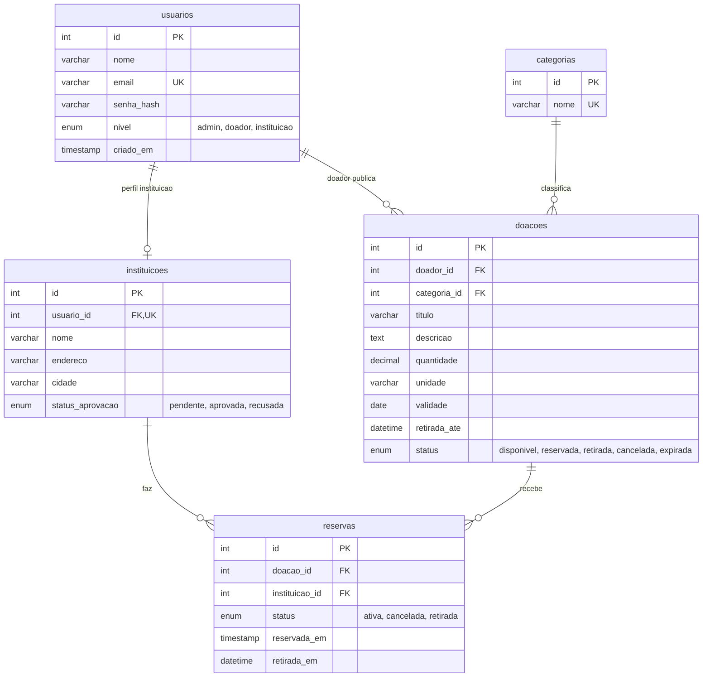

# Ponte Alimentar

Sistema web que conecta estabelecimentos com alimentos excedentes (mercados, padarias, restaurantes) a instituições que atendem pessoas em situação de vulnerabilidade (ONGs, abrigos, cozinhas comunitárias).

> **Status:** Entrega 3 concluída — CRUD completo de doações, reservas, permissões por perfil verificadas na API e interface web (HTML, CSS e JavaScript com DOM e Fetch).
> Entregas anteriores: 1 (problema e estrutura) e 2 (banco de dados, cadastro, login e JWT).

---

## 1. Problema identificado

### Contexto
Diariamente, estabelecimentos descartam alimentos ainda próprios para consumo: produtos perto da validade, sobras de produção, itens com embalagem danificada ou excesso de estoque. Ao mesmo tempo, instituições sociais precisam de alimentos para atender famílias em situação de insegurança alimentar.

O problema não é apenas a falta de alimento, mas a **falta de comunicação organizada** entre quem tem excedente e quem precisa dele. Hoje essa conexão acontece por contatos informais (ligações, grupos de mensagens, conhecidos), o que gera:

- doações que não acontecem porque o alimento vence antes de alguém saber que ele existe;
- doadores sem canal simples para oferecer o excedente;
- instituições que não sabem o que está disponível nem quando retirar;
- falta de registro e acompanhamento do que foi doado e retirado.

### Dados oficiais
- **Desperdício no mundo:** segundo o Relatório do Índice de Desperdício de Alimentos 2024 do Programa das Nações Unidas para o Meio Ambiente (UNEP), foram desperdiçadas cerca de **1,05 bilhão de toneladas de alimentos em 2022**, aproximadamente **19% de todo o alimento disponível aos consumidores**. No mesmo ano, 783 milhões de pessoas passaram fome no mundo e cerca de um terço da humanidade enfrentou insegurança alimentar. O varejo e os serviços de alimentação (mercados, padarias, restaurantes) respondem por 12% e 28% do total desperdiçado, respectivamente. [1]
- **Insegurança alimentar no Brasil:** segundo a PNAD Contínua – Segurança Alimentar 2024, do IBGE, **24,2% dos domicílios brasileiros** (cerca de 18,9 milhões de lares, onde vivem aproximadamente 54,7 milhões de pessoas) conviviam com algum grau de insegurança alimentar. Houve melhora em relação a 2023 (27,6%), mas aproximadamente um em cada quatro domicílios continua nessa situação. [2]

Os números mostram o contraste que motiva o projeto: há alimento sendo perdido em toda a cadeia enquanto milhões de pessoas ainda não têm acesso regular à comida. A Ponte Alimentar atua justamente na etapa em que o alimento excedente de estabelecimentos pode chegar a quem atende essas famílias.

### Público afetado
- **Estabelecimentos doadores:** perdem alimento e não têm canal simples para doar.
- **Instituições sociais:** têm dificuldade de acessar alimentos e de planejar a retirada.
- **Famílias atendidas pelas instituições:** são o público final, afetado pela falta de alimento.
- **Comunidade em geral:** sofre os impactos sociais e ambientais do desperdício.

### Justificativa
Uma plataforma centralizada reduz o tempo entre o surgimento do excedente e a retirada, organiza as doações com prazo e status e deixa um histórico verificável. A solução é viável com tecnologias web simples e pode ser adotada por pequenos estabelecimentos.

---

## 2. Proposta de solução

A **Ponte Alimentar** é uma aplicação web em que:

1. um **doador** publica um lote de alimento com quantidade, validade e prazo de retirada;
2. uma **instituição aprovada** vê as doações disponíveis e reserva as que consegue retirar;
3. o doador **confirma a retirada**, e o sistema registra o histórico;
4. um **administrador** valida as instituições e acompanha o funcionamento geral.

### Objetivos
- **Geral:** reduzir o desperdício de alimentos aproximando doadores e instituições.
- **Específicos:**
  - permitir a publicação e o gerenciamento de doações com validade e prazo;
  - evitar que um mesmo lote seja reservado por mais de uma instituição;
  - garantir que só instituições verificadas recebam doações;
  - manter histórico de doações, reservas e retiradas;
  - proteger os dados com autenticação JWT e controle de acesso por perfil.

### Tecnologias
HTML5, CSS3, JavaScript (DOM + Fetch), Node.js, Express, MySQL, `mysql2`, `jsonwebtoken`, `bcryptjs`, `dotenv`, `cors`.

---

## 3. Funcionalidades

### Implementadas (Entregas 1 a 3)

| Área | Funcionalidade |
|---|---|
| Acesso | Cadastro de doador e instituição; login com JWT; senhas com hash; proteção de rotas por perfil |
| Doações | **CRUD completo** (criar, listar, consultar, editar, excluir); filtros por categoria, status e validade; republicação de doações expiradas |
| Reservas | Reservar doação disponível; cancelar reserva (a doação volta a ficar disponível); confirmar retirada |
| Administração | Aprovar ou recusar instituições; CRUD de categorias; listar usuários; ver e excluir qualquer doação; resumo com totais |
| Interface | Páginas de login, cadastro e um painel para cada perfil (doador, instituição, administrador) |

### Previstas para a Entrega 4
- Edição e exclusão de usuários pelo administrador (hoje há apenas a listagem).
- Histórico e indicadores mais completos (quantidade total doada, por período).
- Refinamento do tratamento de erros e da apresentação final.
- README final com instalação, execução e instruções de teste.

---

## 4. Tipos de usuário e permissões

| Perfil | Quem é | Ações permitidas |
|---|---|---|
| **Doador** | Estabelecimento com excedente | Cadastrar-se; criar, editar e excluir **suas** doações; ver as reservas de suas doações; confirmar retirada |
| **Instituição** | ONG, abrigo, cozinha comunitária | Cadastrar-se (aguarda aprovação); ver doações disponíveis; reservar (se aprovada) e cancelar **suas** reservas; ver seu histórico |
| **Administrador** | Responsável pela plataforma | Aprovar/recusar instituições; listar usuários; gerenciar categorias; ver e excluir qualquer doação; cancelar reservas |

> As permissões são validadas **na API** (middleware de autorização + conferência do dono do recurso no controller), e não apenas escondendo botões ou páginas no front-end. Um doador que tente chamar uma rota de administrador diretamente recebe `403`, mesmo sem usar a interface.

---

## 5. Fluxo básico de funcionamento

```text
Cadastro → Login (JWT) → Redirecionamento conforme o perfil

DOADOR                      INSTITUIÇÃO                 ADMINISTRADOR
  │                              │                            │
  │                              │  cadastro ──────────────►  │ aprova / recusa
  │                              │ ◄────────── aprovada ────  │
  │ publica doação               │                            │
  │ (status: disponível) ───────►│ lista doações disponíveis  │
  │                              │ reserva (status: reservada)│
  │ ◄──── vê a reserva ──────────│                            │
  │ confirma retirada            │                            │
  │ (status: retirada)           │ histórico atualizado       │ acompanha o resumo
```

Fluxos alternativos:
- A instituição cancela a reserva e a doação volta para *disponível*.
- A validade ou o prazo de retirada passa e a doação é marcada como *expirada* (o doador pode editar as datas para publicá-la novamente).
- O doador exclui a doação antes de qualquer reserva.

---

## 6. Banco de dados

Script de instalação em [`sql/ponte_alimentar.sql`](sql/ponte_alimentar.sql) (MySQL 8+). Ele cria o banco `ponte_alimentar`, as tabelas, os relacionamentos e as categorias iniciais **sem apagar nada**: usa `CREATE ... IF NOT EXISTS` e pode ser executado novamente preservando usuários, doações e todo o histórico (as categorias iniciais só são inseridas quando a tabela está vazia).

Para recomeçar do zero em desenvolvimento existe um arquivo separado e identificado, [`sql/reset_banco_desenvolvimento.sql`](sql/reset_banco_desenvolvimento.sql), que **apaga o banco inteiro** e não deve ser usado com dados reais.



| Tabela | Função | Chaves e restrições |
|---|---|---|
| `usuarios` | Todos os perfis do sistema | PK `id`; `email` único; `nivel` limitado a admin/doador/instituicao; guarda apenas `senha_hash` |
| `instituicoes` | Dados extras de quem tem perfil instituição | PK `id`; FK `usuario_id` → `usuarios` (única, relação 1:1); aprovação pelo admin |
| `categorias` | Tipos de alimento | PK `id`; `nome` único |
| `doacoes` | Lotes publicados pelos doadores | PK `id`; FK `doador_id` → `usuarios`; FK `categoria_id` → `categorias`; `quantidade > 0` |
| `reservas` | Reserva de uma doação por uma instituição | PK `id`; FK `doacao_id` → `doacoes`; FK `instituicao_id` → `instituicoes`; **índice único garante só uma reserva ativa por doação** |

---

## 7. Autenticação e controle de acesso

- **Cadastro** (`POST /auth/cadastro`): valida nome, e-mail, senha (mínimo 8 caracteres) e perfil. O cadastro público aceita apenas `doador` e `instituicao`; **o perfil `admin` não pode ser criado pela API** (é criado pelo `npm run seed`). Instituições são gravadas como `pendente`. Usuário e instituição são salvos em uma **transação**.
- **Proteção das senhas:** hash com `bcryptjs` (custo 10). Nenhuma senha em texto puro é gravada ou devolvida pela API.
- **Login** (`POST /auth/login`): para e-mail inexistente ou senha errada a resposta é a mesma, para não revelar quais e-mails existem.
- **JWT:** o token é assinado com `JWT_SECRET` (definido no `.env`), contém `id` e `nivel` e tem validade configurável (padrão 2h). O cliente o envia no cabeçalho `Authorization: Bearer <token>`.
- **Middleware de autenticação** (`autenticacaoMiddleware.js`): rejeita requisições sem token, com token inválido, adulterado ou expirado (401).
- **Middleware de autorização** (`autorizacaoMiddleware.js`): `permitir('admin')`, `permitir('doador', 'admin')` etc. rejeitam perfis não autorizados (403).
- **Conferência do dono do recurso:** além do perfil, os controllers verificam se a doação ou reserva pertence a quem está pedindo (um doador não altera a doação de outro; uma instituição não cancela a reserva de outra).
- **Aprovação da instituição** é conferida no banco a cada reserva (e não no token), pois o status pode mudar depois do login.

---

## 8. Regras de negócio e validações (back-end)

| Regra | Onde é garantida |
|---|---|
| Título (3 a 150 caracteres), quantidade maior que zero, unidade e categoria válidas | `doacoesController` (validação) e `CHECK` no banco |
| Não é possível publicar doação com validade vencida | `doacoesController` |
| O prazo de retirada deve estar no futuro e não pode ser posterior à validade | `doacoesController` |
| Apenas instituições **aprovadas** reservam | `reservasController` (consulta o status no banco) |
| Um lote só tem **uma reserva ativa** por vez | Transação com `SELECT ... FOR UPDATE` + índice único em `reservas` |
| O doador só edita ou exclui as **próprias** doações | `doacoesController` (dono ou admin) |
| Doação reservada ou retirada não pode ser editada nem excluída | `doacoesController` (409) |
| Doações vencidas viram *expiradas* automaticamente | `database/rotinas.js`, executada ao listar, consultar e reservar |
| Cancelar a reserva devolve a doação para *disponível* | `reservasController` (transação) |
| Só o doador dono (ou admin) confirma a retirada | `reservasController` |
| Categoria em uso não pode ser excluída | Chave estrangeira + tratamento do erro (409) |

Códigos de resposta usados: `200`/`201` sucesso, `400` dados inválidos, `401` não autenticado, `403` sem permissão, `404` não encontrado, `409` conflito com o estado atual do recurso, `500` erro interno.

---

## 9. Arquitetura do back-end

Padrão: **routes → middlewares → controllers → database**, com `server.js` apenas configurando a aplicação.

```text
Cliente (HTML/CSS/JS via Fetch) ──JSON──► API Express (server.js)
   └► Middlewares (CORS, autenticação JWT, autorização por perfil)
        └► Routes ► Controllers ► SQL parametrizado ► MySQL
```

### Estrutura de pastas

```text
ponte-alimentar/
├── backend/
│   ├── server.js                         (configura o Express, a API e o front-end estático)
│   ├── routes/
│   │   ├── authRoutes.js                 (cadastro, login, perfil)
│   │   ├── usuariosRoutes.js             (admin)
│   │   ├── instituicoesRoutes.js         (admin)
│   │   ├── categoriasRoutes.js           (leitura: logado; escrita: admin)
│   │   ├── doacoesRoutes.js              (CRUD de doações)
│   │   └── reservasRoutes.js             (reservar, cancelar, confirmar retirada)
│   ├── controllers/
│   │   ├── authController.js
│   │   ├── usuariosController.js
│   │   ├── instituicoesController.js
│   │   ├── categoriasController.js
│   │   ├── doacoesController.js
│   │   └── reservasController.js
│   ├── middlewares/
│   │   ├── autenticacaoMiddleware.js     (valida o JWT)
│   │   ├── autorizacaoMiddleware.js      (restringe por perfil)
│   │   └── corsMiddleware.js
│   ├── database/
│   │   ├── conexao.js                    (pool MySQL)
│   │   ├── rotinas.js                    (expiração de doações, busca de instituição)
│   │   └── seed.js                       (cria o administrador inicial)
│   ├── .env.example
│   └── package.json
├── frontend/
│   ├── login.html  cadastro.html
│   ├── doador.html  instituicao.html  admin.html
│   ├── css/style.css
│   └── js/
│       ├── api.js                        (sessão, Fetch, utilitários de DOM)
│       ├── login.js  cadastro.js
│       └── doador.js  instituicao.js  admin.js
├── sql/
│   ├── ponte_alimentar.sql               (instalação segura: não apaga dados)
│   └── reset_banco_desenvolvimento.sql   (DESTRUTIVO: só para desenvolvimento)
├── .gitignore
└── README.md
```

### Rotas da API

| Método | Rota | Acesso | Descrição |
|---|---|---|---|
| POST | `/auth/cadastro` | Público | Cadastra doador ou instituição |
| POST | `/auth/login` | Público | Autentica e devolve o JWT |
| GET | `/auth/me` | Autenticado | Dados do usuário do token |
| GET | `/usuarios` | Admin | Lista usuários (sem senha) |
| GET | `/usuarios/:id` | Admin | Busca usuário por ID |
| GET | `/instituicoes?status=` | Admin | Lista instituições |
| PUT | `/instituicoes/:id/aprovacao` | Admin | Aprova ou recusa instituição |
| GET | `/categorias` | Autenticado | Lista categorias |
| POST | `/categorias` | Admin | Cria categoria |
| PUT | `/categorias/:id` | Admin | Renomeia categoria |
| DELETE | `/categorias/:id` | Admin | Exclui categoria (se não estiver em uso) |
| GET | `/doacoes?status=&categoria_id=&validade_ate=` | Autenticado | Doador: as suas · Instituição: as disponíveis · Admin: todas |
| GET | `/doacoes/:id` | Autenticado | Detalhe (respeitando a visibilidade do perfil) |
| POST | `/doacoes` | Doador, Admin | Publica doação |
| PUT | `/doacoes/:id` | Doador (dono), Admin | Edita doação disponível ou expirada |
| DELETE | `/doacoes/:id` | Doador (dono), Admin | Exclui doação disponível ou expirada |
| GET | `/reservas` | Autenticado | Instituição: as suas · Doador: as de suas doações · Admin: todas |
| POST | `/reservas` | Instituição aprovada | Reserva uma doação (`{ "doacao_id": 1 }`) |
| PUT | `/reservas/:id/cancelar` | Instituição (dona), Admin | Cancela a reserva |
| PUT | `/reservas/:id/retirada` | Doador (dono da doação), Admin | Confirma a retirada |

---

## 10. Front-end

Interface em HTML, CSS e JavaScript puro, servida pela própria API em `http://localhost:3000/login.html`.

| Página | Perfil | O que faz |
|---|---|---|
| `login.html` / `cadastro.html` | Público | Autenticação e criação de conta (os campos da instituição só aparecem quando o perfil é instituição) |
| `doador.html` | Doador | Formulário de doação (criar e editar), lista com filtros, exclusão, confirmação de retirada e resumo |
| `instituicao.html` | Instituição | Aviso do status de aprovação, doações disponíveis com filtros, reserva, e "Minhas reservas" com cancelamento |
| `admin.html` | Administrador | Abas de instituições (aprovar/recusar), doações, categorias (CRUD) e usuários, com resumo |

- **DOM:** as listas e os formulários são montados e atualizados por JavaScript (`el()` em `api.js`), sem `innerHTML`, de modo que textos digitados pelos usuários são exibidos como texto e não como código.
- **Fetch:** todas as chamadas passam pela função `api()`, que envia o token JWT, trata erros e redireciona para o login quando a sessão expira.
- **Navegação por perfil:** cada página confere o perfil ao abrir, mas isso é só conforto de navegação; a segurança real está na API.

---

## 11. Fontes

1. UNEP – Programa das Nações Unidas para o Meio Ambiente. *Food Waste Index Report 2024* (publicado em 27/03/2024). https://www.unep.org/index.php/news-and-stories/press-release/world-squanders-over-1-billion-meals-day-un-report
2. IBGE. *PNAD Contínua – Segurança Alimentar 2024* (divulgada em 10/10/2025). https://agenciadenoticias.ibge.gov.br/pt/agencia-noticias/44728-mais-de-dois-milhoes-de-lares-saem-da-inseguranca-alimentar-em-2024.html

---

## 12. Cronograma das entregas

| Entrega | Foco | Situação |
|---|---|---|
| 1 | Problema, proposta e estrutura inicial | Concluída |
| 2 | Banco de dados, autenticação e JWT | Concluída |
| 3 | CRUD, integração e permissões | Concluída |
| 4 | Projeto completo, documentação e apresentação | Pendente |
